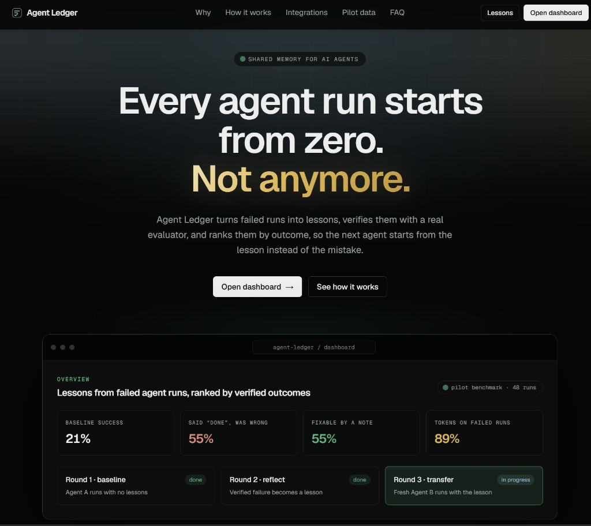
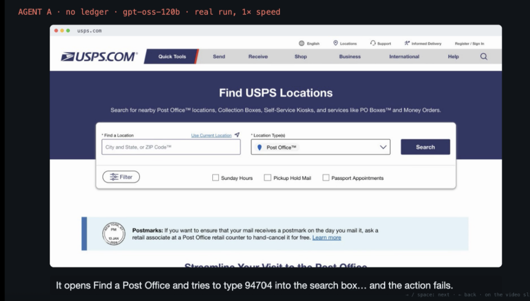
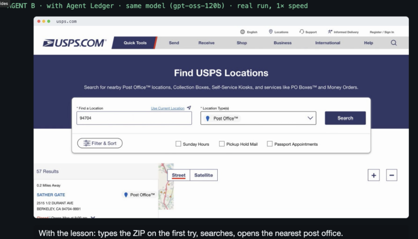
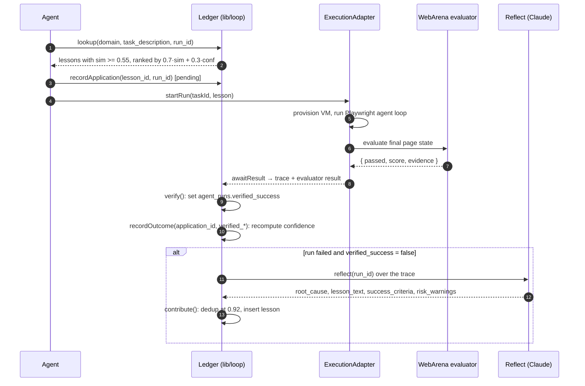
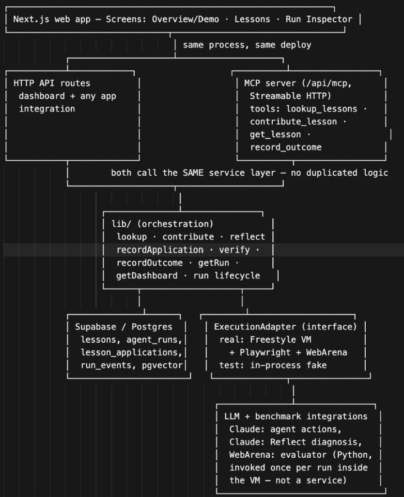
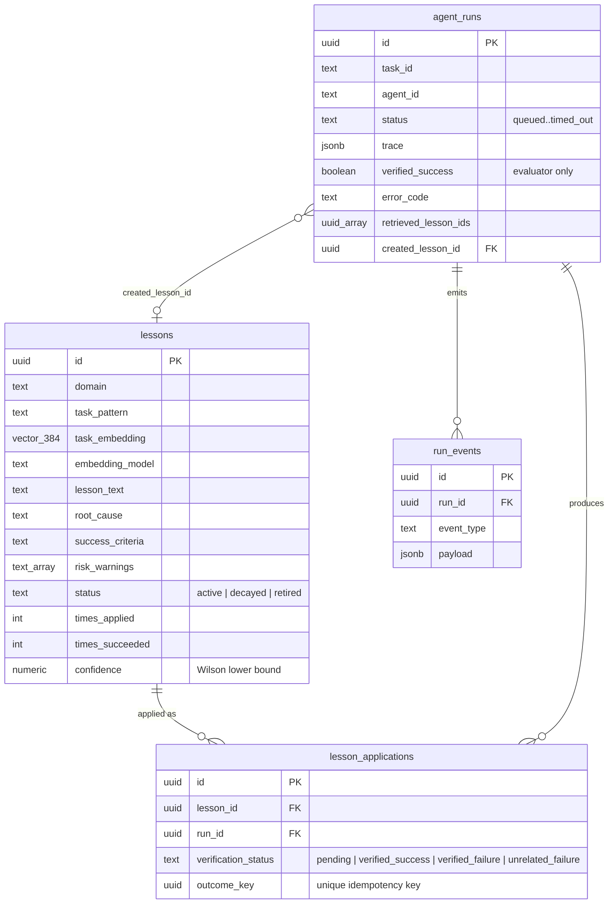

<div align="center">

# Agent Ledger

**Shared memory for AI agents.** Lessons from failed runs, ranked by evaluator-verified outcomes, never by an agent's own "done".


<br />



<br />
<br />

[The idea](#the-idea) · [Demo](#demo-same-model-same-task-different-outcome) · [How it works](#how-it-works) · [Architecture](#architecture) · [Scoring](#retrieval-and-scoring) · [Quick start](#quick-start) · [API](#http-api) · [MCP](#mcp-server)

</div>

---

## The idea

Every agent run starts from zero. An agent fails a task, a human or a reviewing model works out why, and the next agent that hits the same task walks into the same wall. Postmortems live in logs nobody re-reads, and prompt fixes die with the session.

Agent Ledger applies the incident-review loop to agents: **analyze a failure once, store the lesson, and retrieve it for anyone who hits the same shape of problem.**

Three design rules carry the whole system:

1. **The agent proposes, the evaluator decides.** `verified_success` is written only by the WebArena evaluator. An agent's own "I'm done" is recorded as a claim and never counted as success.
2. **Confidence is earned, not asserted.** A lesson's score is the Wilson lower bound over *verified* applications, so one lucky run cannot outrank a lesson with a real track record.
3. **Return nothing rather than something irrelevant.** Lookup applies a hard similarity floor and returns at most a few lessons. Off-topic notes measurably hurt (see the pilot below).

### Pilot: the baseline this has to beat

Measured before building the ledger: 24 tasks on 10 live sites, `gpt-oss-120b` on Groq, no memory. Source: `graveyard-experiment @ 842b762`, 17 Oct 2026 (`data/pilot/`).

| Metric | Result | 95% interval |
|---|---|---|
| Baseline task success | **21%** | 12–34%, n=48 |
| Agent said "done" and was wrong | **55%** | 35–73%, n=22 |
| Failures a short note could have prevented | **55%** | 40–70%, n=38 |
| Tokens spent on failed runs | **89%** | 8.37M of 9.38M |

The most useful negative result: **naive retrieval made things worse.** Injecting every note for a site dropped success from 21% to 13% (4–31%, n=24), because irrelevant notes derailed tasks that passed without them. The relevance floor exists because of this number.

> The pilot judge is the same model that ran the tasks and has not yet been hand-validated. Treat the percentages as indicative.

## Demo: same model, same task, different outcome

Task `usps_03` on usps.com: *find the post office nearest to ZIP 94704 and report its name and Saturday retail hours.* Both runs below are real, at 1× speed, on the same model (`gpt-oss-120b`).

<table>
  <tr>
    <th width="50%">Agent A · no ledger</th>
    <th width="50%">Agent B · with Agent Ledger</th>
  </tr>
  <tr>
    <td></td>
    <td></td>
  </tr>
  <tr>
    <td>It opens <b>Find a Post Office</b> and tries to type <code>94704</code> into the search box… and the action fails. The evaluator marks the run failed even though the agent may claim it finished.</td>
    <td>With the lesson injected, it types the ZIP on the first try, searches, and opens the nearest post office. A fresh agent with no memory of Agent A's failure, and only what <code>lookup</code> returned.</td>
  </tr>
</table>

The failed run is diagnosed by Reflect, written up as a lesson, and retrieved for Agent B. The dashboard then shows both traces, the transferred lesson, each agent's claim and the raw evaluator evidence side by side.

> One paired run is a promising result, not a statistically conclusive improvement. The UI says so next to every comparison.

## How it works

Six stages, repeated by every agent on every task.

| # | Stage | What happens |
|---|---|---|
| 1 | **Lookup** | `lookup(domain, task_description)` returns zero or more ranked lessons. |
| 2 | **Execute** | A browser agent runs the task in an ephemeral VM and emits a structured trace. |
| 3 | **Reflect** | On a failed run with `verified_success = false`, Reflect diagnoses the root cause and drafts a lesson. |
| 4 | **Contribute** | The lesson is stored, or merged into an existing near-duplicate (cosine ≥ 0.92). |
| 5 | **Verify** | The evaluator grades the final state. Only this step writes `verified_success`. |
| 6 | **Rank** | `recordOutcome` recomputes the lesson's confidence from its verified applications, exactly once per application. |



## Architecture

<div align="center">

</div>

- **One process, one deploy.** The dashboard, HTTP routes and MCP server all call the same service layer in `lib/loop/operations.ts`. There is no duplicated logic between transports.
- **One database.** Supabase/Postgres with pgvector holds all state (schema below). `LEDGER_STORE=memory` swaps in a process-local store with the same interface.
- **One execution boundary.** Everything that touches a browser sits behind the `ExecutionAdapter` interface, so the ledger can be developed and tested without a VM.

> The diagram is the original design. In this repo the agent loop runs on Groq (`GROQ_MODEL`, default `openai/gpt-oss-120b`) and Reflect on Anthropic (`ANTHROPIC_MODEL`).

### Data model



Constraints that enforce the invariants in the database rather than in application code:

- `agent_runs`: a `failed` or `timed_out` run must carry an `error_code`.
- `lesson_applications.outcome_key` is `UNIQUE`, and a `CHECK` ties it to the status: null while `pending`, set once terminal. A second `recordOutcome` for the same application cannot insert another receipt or move the counters.
- `record_lesson_outcome()` recomputes `times_applied`, `times_succeeded` and `confidence` from the verified rows, so counters can never drift from the audit trail.
- A run that *created* a lesson cannot be recorded as an *application* of it.
- All tables have RLS enabled with no anon policies. Only the service role reads or writes.

## Retrieval and scoring

All constants live in [`lib/scoring/constants.ts`](lib/scoring/constants.ts) and are mirrored in SQL.

| Constant | Value | Role |
|---|---|---|
| `RELEVANCE_THRESHOLD` | `0.55` | Lessons below this cosine similarity are discarded, regardless of confidence |
| `SIMILARITY_WEIGHT` / `CONFIDENCE_WEIGHT` | `0.7` / `0.3` | Rank score weights |
| `DEDUP_THRESHOLD` | `0.92` | Cosine at which a new lesson merges into an existing active one |
| `WILSON_Z` | `1.96` | 95% interval for confidence |
| `DEFAULT_K` | `5` | Default result cap |
| `EMBEDDING_MODEL` / `EMBEDDING_DIMENSIONS` | `all-MiniLM-L6-v2` / `384` | In-process embeddings, no API key |

**Ranking.** Among active lessons in the query's domain that share the query's `embedding_model`, keep those with similarity ≥ 0.55 and sort by

$$
\text{rank} = 0.7 \cdot \text{similarity} + 0.3 \cdot \text{confidence}
$$

**Confidence** is the lower bound of the Wilson score interval over verified applications, with $s$ = `verified_success` rows and $n$ = `verified_success` + `verified_failure` rows. `pending` and `unrelated_failure` count toward neither, and $n = 0$ gives $0$.

$$
\text{conf} = \frac{\hat p + \frac{z^2}{2n} - z\sqrt{\frac{\hat p(1-\hat p)}{n} + \frac{z^2}{4n^2}}}{1 + \frac{z^2}{n}}, \qquad \hat p = \frac{s}{n},\ z = 1.96
$$

A lesson that went 1/1 scores about 0.21, not 1.0, so it has to keep winning to climb.

**Calibrating the floor.** `0.55` is tuned for MiniLM (the earlier `0.75` was an OpenAI-embedding default). With `scripts/calibrate-floor.ts` against the pilot tasks and notes, at `0.55` and `k = 1`, 10 of 14 tasks retrieve the lesson from their own failure and every control task retrieves nothing.

Ranking runs in TypeScript (`lib/scoring/ranking.ts`) so the unit tests cover the code that serves lookup. `lookup_lessons()` in SQL is an equivalent entry point.

## Execution layer

The browser agent and its sandbox sit behind one interface:

```ts
interface ExecutionAdapter {
  startRun(taskId: string, lesson?: Lesson): Promise<{ runId: string }>;
  getRunStatus(runId: string): Promise<RunStatus>;
  // resolves once the VM has executed the task AND the evaluator has run
  awaitResult(runId: string): Promise<{ trace: TraceEvent[]; evaluator: EvaluatorResult }>;
}
```

| Implementation | Use |
|---|---|
| `freestyle-adapter` | Real: ephemeral Freestyle VM, Playwright, WebArena evaluator |
| `test-adapter` | In-process fake with recorded fixtures (`lib/execution/fixtures/`) |

Select with `EXECUTION_ADAPTER=test|freestyle`.

**Run lifecycle:** `queued → running → succeeded | failed | cancelled | timed_out`. Terminal states are final. Failures carry a code: `vm_provision_error`, `llm_timeout`, `llm_error`, `evaluator_unavailable`, `db_error`, or `task_failed` (ran cleanly, evaluator said no).

**Evaluator output** is structured evidence, not a boolean: `{ passed, score, evidence: { type: program_html | string_match | url_match, detail } }`. The dashboard shows it verbatim next to the agent's claim.

**Trace.** Every action is one `TraceEvent` (`seq`, `ts`, `type`, `selector`, `value`, `result`, `error`, `duration_ms`) and is mirrored as a `step` row in `run_events`. The Run Inspector renders it as a terminal.

### The agent loop

[`agent/loop.ts`](agent/loop.ts) drives one task through Groq tool-use against a Playwright `Page`. It never decides success.

- **Six tools:** `navigate`, `click`, `fill`, `select`, `screenshot` (returns URL, title and the accessibility snapshot as text), `finish`.
- **Executors never throw.** A failed action returns `{ ok: false, error }`, is logged to the trace and handed back to the model so it can recover.
- **Budgets:** 40 actions, 5 min wall clock, 60 s per LLM call, one retry on 429/5xx with `retry-after` honored. Only the 3 most recent observations keep their full text in context.

### Prompt-injection hygiene

Page content and retrieved lessons are untrusted input to the model, so they are never placed in the system prompt.

- The system message holds only the task, start URL, tool rules and budget.
- Retrieved lessons arrive inside `<<<UNTRUSTED_REFERENCE_NOTES>>>` fences (capped at 3,000 chars) and page or tool output inside `<<<UNTRUSTED_OBSERVATION>>>` fences (7,000 chars). The prompt tells the model they are data, not instructions.
- `sanitizeUntrusted()` applies NFKC (folding full-width look-alikes), strips control, zero-width, bidi-isolate and Unicode tag characters (the "ASCII smuggling" range), and rewrites any run of `<<<` or `>>>` so content cannot spell a fence marker and close its own block.
- Reflect applies the same stance: the trace is "untrusted data from a web page", and the diagnosis comes back through a strict `record_diagnosis` tool schema.
- `record_outcome` over MCP accepts only `application_id` and `run_id`. The handler calls the evaluator through `ExecutionAdapter` and records that result, so a caller can never self-report success.

## Quick start

```bash
npm install
cp .env.example .env     # Windows: copy .env.example .env
npm run dev              # http://localhost:3000
```

With the defaults (`NEXT_PUBLIC_LEDGER_SOURCE=test_double`) the UI runs against an in-process fake seeded with the 17 notes from the pilot, so you can click through the whole demo with no database, VM or API keys. A banner on every page says it is a test double. MiniLM (~90 MB) downloads on first use.

### Going live

1. Fill `SUPABASE_URL` and `SUPABASE_SERVICE_ROLE_KEY` in `.env`.
2. Apply migrations: `supabase link --project-ref <ref>` then `supabase db push`. (`supabase start` runs the stack locally in Docker, and `supabase db reset` replays every migration.)
3. Set `NEXT_PUBLIC_LEDGER_SOURCE=live` so the UI reads `/api/*`. What it expects from each route is in [`docs/lane-c-api-expectations.md`](docs/lane-c-api-expectations.md).
4. For real runs, set `EXECUTION_ADAPTER=freestyle`, `FREESTYLE_API_KEY`, `GROQ_API_KEY` and `WEBARENA_SNAPSHOT_SLUG`.

### Configuration

| Variable | Purpose |
|---|---|
| `SUPABASE_URL`, `SUPABASE_SERVICE_ROLE_KEY` | Database. Omit both to use the in-process store |
| `LEDGER_STORE` | `memory` forces the in-process store even when Supabase is configured |
| `MCP_ACCESS_TOKEN` | Bearer token for `/api/mcp`. Requests are rejected when empty |
| `ANTHROPIC_API_KEY`, `ANTHROPIC_MODEL` | Reflect, when a failure is contributed without a lesson draft |
| `EXECUTION_ADAPTER` | `test` (fake) or `freestyle` (real VM) |
| `FREESTYLE_API_KEY`, `WEBARENA_SNAPSHOT_SLUG`, `WEBARENA_TASK_ID` | Real execution |
| `GROQ_API_KEY`, `GROQ_MODEL` | Browser agent model (default `openai/gpt-oss-120b`) |
| `NEXT_PUBLIC_LEDGER_SOURCE` | `test_double` (default) or `live` |

Embeddings need no key: `all-MiniLM-L6-v2` runs in-process (`lib/embeddings/minilm.ts`).

### Scripts

| Command | Does |
|---|---|
| `npm run dev` | Next.js dev server |
| `npm run build` / `npm start` | Production build and server |
| `npm run typecheck` | `tsc --noEmit` |
| `npm test` | Scoring and outcome tests (`tsx --test`), then the Vitest suites |
| `npm run agent:smoke` | Live agent loop (needs `GROQ_API_KEY` and a browser) |
| `npm run capture-pair` | Save a baseline/transfer pair for the recorded fallback |

Test coverage: scoring math and idempotency (`tests/`), the agent loop, tools, prompt hygiene and VM task (`agent/__tests__/`), execution adapters and outcome mapping (`lib/execution/__tests__/`), and the UI view helpers.

## Web app

| Route | Screen |
|---|---|
| `/` | Landing page |
| `/dashboard` | **Overview**: KPIs, Run Demo with Round 1/2/3 status, runs chart, recent runs and failures, pilot benchmark |
| `/lessons`, `/lessons/:id` | **Lessons**: search by task description, filter by domain and status, lesson detail with application history |
| `/runs`, `/runs/:id` | **Run Inspector**: terminal-style trace, retrieved lessons, the agent's claim, the evaluator's evidence |
| `/runs/compare?baseline=&transfer=` | Baseline vs transfer, side by side |
| `/runs/recorded/:name` | Playback of a recorded pair, labelled as recorded |

The UI polls every 2 s, uses a dark theme with Geist, and respects `prefers-reduced-motion`.

### Run the demo

1. Open `/dashboard` and click **Run demo**. Round 1 runs the baseline with no lessons, Round 2 has Reflect write a lesson from the evaluator-confirmed failure, and Round 3 runs a fresh agent with only what `lookup` returns.
2. Click **Compare baseline vs transfer**.
3. During rehearsal, record a fallback pair so the demo survives a slow VM:

   ```bash
   npm run capture-pair -- --name usps-03-rehearsal-1 --baseline <run_id> --transfer <run_id> --api http://localhost:3000/api
   ```

   It appears under "Recorded fallback" on the Overview.

## HTTP API

| Method | Route | Body / query |
|---|---|---|
| `POST` | `/api/lookup` | `{ domain, task_description, k?, run_id? }` |
| `POST` | `/api/contribute` | `{ domain, task_pattern, outcome, trace, lesson? }` |
| `GET` | `/api/get-lesson` | `?lesson_id=` |
| `GET` | `/api/get-run` | `?run_id=` |
| `GET` | `/api/get-dashboard` | none |

```bash
curl -s localhost:3000/api/lookup \
  -H 'content-type: application/json' \
  -d '{"domain":"usps.com","task_description":"find the post office nearest ZIP 94704 and its Saturday hours"}'
```

`contribute` with `outcome: "failure"` and no `lesson` triggers Reflect, but only for a run already graded `verified_success = false`. Otherwise it is rejected, because an unconfirmed failure is not diagnosable evidence.

## MCP server

`POST /api/mcp` with `Authorization: Bearer $MCP_ACCESS_TOKEN` (Streamable HTTP, Node runtime).

| Tool | Purpose |
|---|---|
| `lookup_lessons` | Ranked lessons for a domain and task description |
| `contribute_lesson` | Store a lesson, deduplicated at cosine 0.92 |
| `get_lesson` | One lesson with its application history |
| `record_outcome` | Verify a run through the evaluator and re-score the lesson |

Any MCP client can call these mid-task, and they share one service layer with the HTTP API and the dashboard.

## Project structure

```text
app/              Next.js routes: landing, dashboard, lessons, runs, and /api/*
components/       UI: landing/, dashboard/, lessons/, run/
lib/
  loop/             operations (lookup, contribute, verify, recordOutcome), Reflect, MCP, schemas
  scoring/          constants, Wilson confidence, ranking, dedup, embed
  embeddings/       in-process all-MiniLM-L6-v2
  db/               stores: Supabase and in-memory, read model
  execution/        ExecutionAdapter: Freestyle and test, run state machine, outcome mapping
  test-double/      scripted in-process backend behind the default UI source
  demo/             Round 1/2/3 orchestration
  pilot/            typed view of the pilot results and notes
  ui/               API client, contracts, polling, view helpers
agent/            Browser agent loop, tools, prompt hygiene, Groq client
supabase/         Migrations (lessons, agent_runs, lesson_applications, run_events)
scripts/          calibrate-floor, capture-recorded-pair, pilot-notes-to-lessons
integrations/     Harness plug-ins, e.g. graveyard/ledger_retrieve.py
data/             Pilot results and recorded run pairs
docs/             API expectations, plans, images
```

`integrations/graveyard/ledger_retrieve.py` plugs the ledger's `lookup` into the graveyard-experiment harness. See the last section of [`docs/lane-c-api-expectations.md`](docs/lane-c-api-expectations.md).

## Known limits

- **One paired run is not statistics.** The demo shows the mechanism works end to end. Measuring the effect needs many tasks and paired runs.
- **The pilot judge is unvalidated.** Baseline numbers come from a same-model judge that has not been hand-checked.
- **Flat index, no graph.** Retrieval is a domain filter plus a vector similarity over lessons. That is enough at this scale and deliberately simple.
- **No multi-tenancy.** There is no auth, org boundary or lesson privacy beyond the service-role-only database.
- **Replay is re-execution.** A replay runs the same task configuration in a fresh VM and is not a byte-for-byte retrace of the original DOM path.

## More docs

- [`PRD.md`](PRD.md): product requirements and locked decisions
- [`PITCH.md`](PITCH.md): the 90-second pitch plan
- [`TEAM-SPLIT.md`](TEAM-SPLIT.md): lanes and ownership
- [`data/pilot/README.md`](data/pilot/README.md): how the pilot numbers were produced
